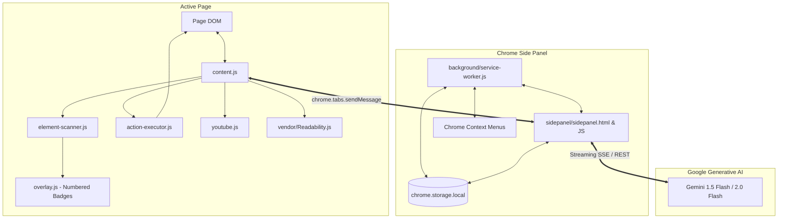

# ✂️ Snip: Chrome Side-Panel AI Agent

[](https://developer.chrome.com/docs/extensions/mv3/intro/)
[](https://ai.google.dev/)
[-brightgreen)](https://nodejs.org/)
[](LICENSE)

> **Snip** is a user-controlled Chrome side-panel AI agent that understands the page currently open in your browser, reasons about visible and interactive content, and safely performs browser actions with explicit **human approval at every step**.

---

## 🌟 Why Snip?

Most AI chatbots exist in an isolated tab, forcing you to copy-paste messy text, explain what you are looking at, and carry out all browser tasks manually. On the other end of the spectrum, autonomous browser bots can be risky, opaque, and unpredictable when interacting with personal data or important forms.

**Snip strikes the sweet spot:**
1. **Always Present in the Side Panel:** Floats right beside your active tab using Chrome's native Side Panel API.
2. **Understands Context:** Reads clean articles via Mozilla Readability, extracts YouTube chapters with clickable timestamps, and inspects visual charts with Gemini Vision.
3. **User in Control (Human-in-the-Loop):** Detects interactive buttons and inputs, labels them with a numbered Action Map, proposes single steps, and waits for your choice: **[Approve & Execute]**, **[Skip]**, or **[Stop]**.
4. **Safety First:** Hard-blocks actions on sensitive fields (`password`, credit cards, CVVs, OTPs) and sensitive domains (banking, auth portals, payment gateways).
5. **Privacy Preserving:** Uses `chrome.storage.local`—your personal profile and API keys never leave your machine.

---

## 🎯 Core Capabilities

| Feature | Description |
|---|---|
| **📝 Article Summarizer** | Extracts clean content using **Mozilla Readability.js**, producing a structured **TL;DR**, **5 Key Points**, and **What to do next**. |
| **▶️ YouTube Summarizer** | Reads public YouTube video metadata and generates chapter notes with **interactive timestamp chips** that jump video playback. |
| **🌐 English & Hinglish Toggle** | One-click switch between crisp English and natural conversational Hinglish. |
| **💬 Grounded Page Chat** | Real-time streaming conversation grounded strictly in the active page's context with zero hallucination. |
| **🖱️ Right-Click AI Actions** | Context menus for selected text: *Explain this*, *Translate*, and *Draft a reply*. |
| **👁️ Screen Vision Q&A** | Captures active tab visible screenshot for multimodal analysis of charts, graphs, and UI diagrams. |
| **🤖 Numbered Action Map** | Traverses page DOM to discover interactive elements and overlays non-intrusive floating badges `[1]`, `[2]`, ... `[N]`. |
| **🤝 Human-In-The-Loop Agent** | Reasons over the Action Map to propose atomic browser actions (**Approve**, **Skip**, or **Stop**). |
| **👤 Local Profile & Autofill** | Saves personal details locally to automatically match and suggest form fills on active pages. |
| **⚡ One-Click Skills** | Library of shortcuts (Action item extractor, ELI5, Table data extractor, and custom prompt templates). |
| **🛡️ Safety Shield** | Unconditionally shields passwords, CVVs, cards, OTPs, and sensitive banking URLs. |

---

## 🏗️ Architecture & Technical Design

Snip is built with **zero external runtime build dependencies** using modern standard Web APIs and Chrome Extension Manifest V3.



For full architectural blueprints, see:
- 📘 [architecture.md](architecture.md) — Comprehensive architecture specification, message schemas, and state machine.
- 📙 [edgecase.md](edgecase.md) — Exhaustive catalog of DOM, SPA, lifecycle, and network edge cases and defensive solutions.
- 📗 [implementation.md](implementation.md) — 4-phase milestone build roadmap and verification criteria.

---

## 🚀 Quick Start / Installation

### 1. Load Unpacked in Google Chrome
1. Clone or download this repository to your computer:
   ```bash
   git clone https://github.com/your-username/snip.git
   ```
2. Open Google Chrome and navigate to:
   ```
   chrome://extensions
   ```
3. In the top right corner, toggle **Developer mode** to **ON**.
4. Click the **Load unpacked** button in the top left.
5. Select the `snip` project folder (e.g., `D:\github projects\snip`).
6. The **Snip - Chrome Side-Panel AI Agent** icon will appear in your Chrome toolbar.

### 2. Configure Your Free Gemini API Key
1. Click the **Snip** extension icon in your Chrome toolbar to open the Side Panel.
2. Click the **⚙️ Settings** tab in the side panel navigation.
3. Paste your free Google Gemini API key from [Google AI Studio](https://aistudio.google.com/app/apikey).
4. Select your preferred model (`Gemini 1.5 Flash` recommended).
5. Click **Save Settings**. You're ready to snip!

---

## 📖 User Walkthrough

### 1. Summarizing Articles & Web Pages
- Open any article (e.g. Wikipedia, a blog, or news article).
- Open Snip and click **📄 Summarize Article**.
- Snip uses Mozilla Readability to strip ads and sidebars, generating a structured **TL;DR**, **5 Key Points**, and **What To Do Next**.
- Toggle between **English** and **Hinglish** using the `🌐 EN / HI` button in the header.

### 2. Summarizing YouTube Videos
- Open any public YouTube video (`youtube.com/watch?v=...`).
- Snip automatically displays a YouTube banner in the Summary tab.
- Click **Summarize Video with Timestamps**.
- Review chapter notes and click any timestamp link (e.g., `⏱️ 04:12`) to **instantly seek** the video player on the page!

### 3. Contextual Page Chat
- Switch to the **💬 Chat** tab.
- Ask questions about the page (e.g., *"What is the main conclusion of this research?"*).
- Snip streams responses in real time, strictly citing the page content and refusing to invent facts.

### 4. Right-Click Quick Actions
- Highlight text on any page -> Right-click -> **Snip AI**:
  - **Explain this selection:** Simplifies jargon.
  - **Translate:** Translates into Hindi/Hinglish.
  - **Draft a reply:** Crafts professional reply options.
- The Side Panel opens automatically to stream the result!

### 5. Multimodal Screen Vision
- Switch to the **👁️ Vision** tab and click **📸 Capture Active Screen**.
- Type a visual question (e.g., *"Explain the bar chart in the top right"*) and click **Ask Gemini Vision**.

### 6. Interactive Element Scanner & Agent Automation
- Switch to the **🤖 Agent** tab and click **🔍 Scan Elements**.
- Watch vibrant numbered badges `[1]`, `[2]`, ... `[N]` appear over all interactive buttons, links, and form fields.
- Enter your goal: *"Fill the practice contact form with my details and submit"*.
- Click **🚀 Propose Next Step**.
- Review the **Action Proposal Card**:
  - Target Element `[#1]` (e.g. `Full Name`)
  - Action Type: `TYPE`
  - Injected Value: `Jane Doe`
  - AI Rationale: `Filling Full Name input field from saved profile`
- Choose:
  - **✅ Approve & Execute:** Dispatches synthetic events to the page DOM.
  - **⏭️ Skip:** Requests alternative action.
  - **🛑 Stop:** Halts immediately and removes badges.
- Check the real-time **Action Audit Log** below to inspect past steps.

### 7. Local Profile & One-Click Autofill
- Switch to the **👤 Profile** tab to enter your details (Name, Email, Phone, Address, Job).
- Click **💾 Save Profile Locally**.
- Click **⚡ Autofill Active Form** on any page to automatically map your profile to form fields and propose approval steps.

---

## 🧪 Testing & Verification

Snip includes a comprehensive automated test suite running on Node.js native test runner (`node --test`) with zero external test dependencies:

```bash
npm test
```

### Test Coverage Highlights:
- ✅ **Prompt Generator (`gemini-prompts.test.js`):** Validates English and Hinglish structured formatting, YouTube chapter prompts, and anti-hallucination chat instructions.
- ✅ **Safety Guardrails (`safety.test.js`):** Tests rejection of internal Chrome URLs, sensitive banking detection, and shielding of `type="password"`, CVV, card numbers, and OTPs.
- ✅ **Profile Autofill Matcher (`profile-autofill.test.js`):** Tests heuristic name, email, phone, and address matching logic.
- ✅ **YouTube Parser (`youtube-parser.test.js`):** Tests timestamp calculation (`02:15` -> 135s) and video ID extraction regex.
- ✅ **Action Planner (`agent-planner.test.js`):** Tests structured JSON action parsing, markdown fence stripping, and action validation.
- ✅ **Element Scanner (`element-scanner.test.js`):** Tests sensitivity classification and selector paths.

---

## 📦 Packaging for Release

To package the extension into a production-ready ZIP file for GitHub Releases:

```bash
npm run package
```

This validates all required files and bundles them into `dist/snip-extension-v1.0.0.zip`.

---

## 📁 Repository Structure

```
snip/
├── manifest.json              # Chrome Extension Manifest V3
├── package.json               # Scripts (test, package, generate-icons)
├── Problemstatement.md        # Original problem statement specification
├── architecture.md            # System architecture and data flow blueprints
├── edgecase.md                # Edge case catalog and defensive strategies
├── implementation.md          # 4-Phase milestone roadmap
├── README.md                  # Complete project documentation
│
├── background/
│   ├── service-worker.js      # Background service worker (Side panel & tabs)
│   └── context-menus.js       # Right-click context menus manager
│
├── content/
│   ├── content.js             # Central content script message router
│   ├── element-scanner.js     # DOM interactive element scanner & action map
│   ├── overlay.js             # Numbered badge overlay manager
│   ├── overlay.css            # High-contrast non-intrusive badge styling
│   ├── action-executor.js     # Synthetic DOM action execution engine
│   └── youtube.js             # YouTube detector, caption reader & player seek
│
├── services/
│   ├── gemini.js              # Google Gemini API client (Streaming & Vision)
│   ├── prompts.js             # Bilingual prompt templates (EN & Hinglish)
│   ├── storage.js             # Typed chrome.storage.local wrapper
│   ├── safety.js              # Safety shield & sensitive domain/field filter
│   ├── profile.js             # User profile store & heuristic form matcher
│   ├── skills.js              # One-click skills & custom recipe engine
│   └── agent-planner.js       # AI single-step action reasoner & JSON validator
│
├── sidepanel/
│   ├── sidepanel.html         # Side panel semantic layout and tabs
│   ├── sidepanel.css          # Responsive native-feel UI stylesheet
│   ├── sidepanel.js           # Master UI bootstrap and coordinator
│   ├── summarize.js           # Article & YouTube summarization controller
│   ├── chat.js                # Grounded in-page chat with streaming
│   ├── agent.js               # Human-in-the-loop action approval controller
│   ├── vision.js              # Screen capture & multimodal Q&A controller
│   ├── profile.js             # Local profile editor & autofill trigger
│   ├── skills.js              # Saved skills list and execution controller
│   └── error-handler.js       # Toast notifications & error handling
│
├── vendor/
│   └── Readability.js         # Mozilla Readability clean article parser
│
├── icons/
│   ├── icon16.png             # 16x16 extension icon
│   ├── icon48.png             # 48x48 extension icon
│   └── icon128.png            # 128x128 extension icon
│
├── scripts/
│   ├── generate-icons.js      # Zero-dependency PNG icon generator
│   └── build-package.js       # Release ZIP packaging script
│
└── tests/
    └── unit/
        ├── gemini-prompts.test.js
        ├── safety.test.js
        ├── profile-autofill.test.js
        ├── youtube-parser.test.js
        ├── agent-planner.test.js
        └── element-scanner.test.js
```

---

## 🔒 Privacy & Safety Guarantee

1. **No External Telemetry:** Snip does not track users, log history to external servers, or transmit browsing habits.
2. **API Keys Stored Locally:** Your Google Gemini API key is stored exclusively in your browser's `chrome.storage.local`.
3. **Guaranteed Human Oversight:** The browser agent will **never** click, type, or submit anything without your explicit approval on each individual step.
4. **Hard-Blocked Sensitive Fields:** Passwords, payment card numbers, CVVs, and banking portals are shielded by design.

---

## 📄 License
This project is licensed under the [MIT License](LICENSE).
