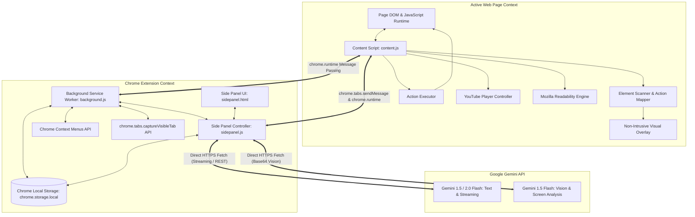
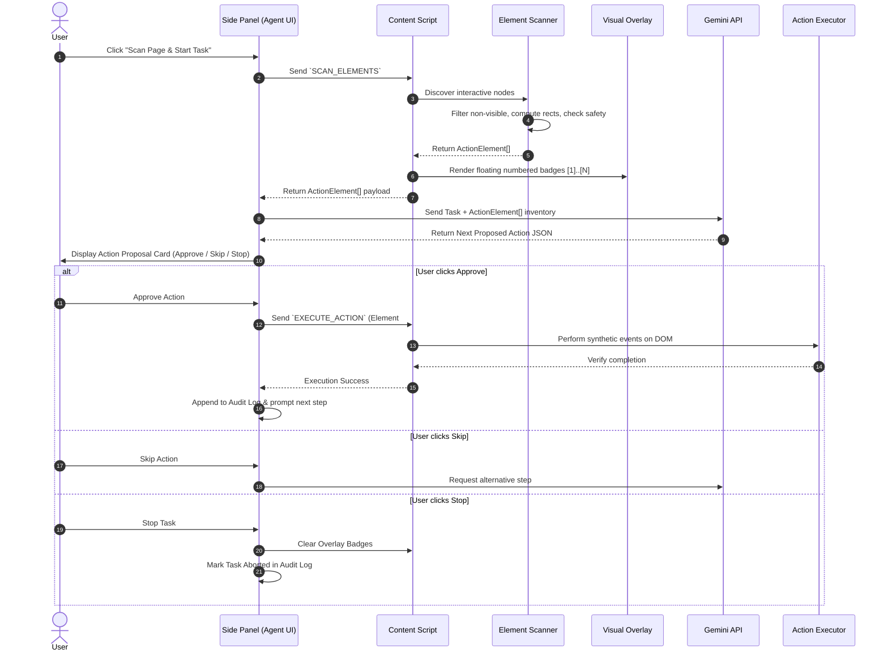
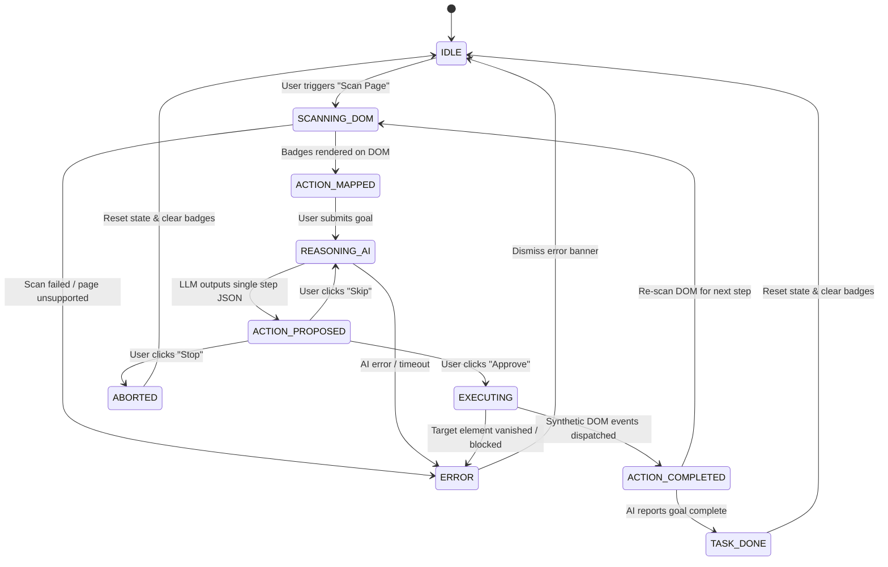

# Snip: Chrome Side-Panel AI Agent - System Architecture

## 1. System Overview & Core Philosophy

**Snip** is an intelligent, user-controlled browser agent built as a Chrome Extension using Manifest V3 (MV3). It operates primarily inside the Chrome Side Panel, allowing users to understand active web pages, interact with content multimodally, and safely execute single-step browser actions with human-in-the-loop approval.

### Core Architectural Principles
1. **User In Control (Human-in-the-loop):** Snip never executes destructive or automated sequences autonomously. Every proposed browser action requires explicit user intervention (**Approve**, **Skip**, or **Stop**).
2. **Context-Grounded Reasoning:** Answers and actions are anchored strictly in the active page's DOM or visible screen capture to prevent hallucinations.
3. **Defense-in-Depth Safety:** Sensitive pages (banking, auth portals, payment gateways) and sensitive fields (passwords, CVV, OTPs, credit cards) are unconditionally shielded from automated interaction.
4. **Zero-Friction Runtime:** Built with standard modern Web APIs, ES modules, and native Chrome Extension APIs. Loads unpacked into Google Chrome with zero build dependencies.
5. **Multi-Model AI Gateway:** Direct client-side integration with Google Gemini APIs (Gemini 1.5 Flash / 2.0 Flash) supporting streaming text, structured JSON function-like outputs, and multimodal vision analysis.

---

## 2. High-Level System Architecture



---

## 3. Component Breakdown

### 3.1 Background Service Worker (`background/service-worker.js`)
The event-driven coordinator of the extension lifecycle:
- **Side Panel Activation:** Handles clicks on the extension action icon to open `sidepanel.html` using `chrome.sidePanel.open` and configures global behavior via `chrome.sidePanel.setPanelBehavior({ openPanelOnActionClick: true })`.
- **Context Menus Management:** Registers context menu items for selected text:
  - `snip-explain`: "Snip: Explain this selection"
  - `snip-translate`: "Snip: Translate selection"
  - `snip-reply`: "Snip: Draft a reply"
- **Screen Capture Relay:** Captures the visible tab via `chrome.tabs.captureVisibleTab(null, { format: 'png' })` and returns base64 payloads to the side panel.
- **Tab State Tracking:** Listens for `chrome.tabs.onActivated` and `chrome.tabs.onUpdated` to notify the side panel when the active page changes or reloads.

### 3.2 Side Panel Interface (`sidepanel/`)
The primary interactive user interface docked alongside any browser tab:
- **`sidepanel.html`:** Clean, accessible semantic layout styled with responsive CSS variables matching native Chrome themes.
- **Navigation Tabs:**
  1. **Summarize:** Article extractor (TL;DR, 5 Key Points, Next Steps), YouTube summarizer with interactive timestamp chips, and English/Hinglish language toggle.
  2. **Chat:** Conversational interface grounded in the active page's extracted DOM, supporting real-time streaming and message history.
  3. **Agent (Action Map):** Numbered interactive element scanner, AI action step proposal card, **Approve / Skip / Stop** controls, and live execution audit log.
  4. **Vision:** Visible screen capture viewer with image inspection and prompt input.
  5. **Profile & Skills:** Local personal profile editor (auto-fill source) and one-click saved skill library.
  6. **Settings:** Secure API key management (Google Gemini), model selector (`gemini-1.5-flash`, `gemini-2.0-flash`, `gemini-1.5-flash-8b`), and fallback configurations.
- **`sidepanel.js`:** Master UI controller managing tab state, API requests, streaming decoders, and event listeners.

### 3.3 Content Script Engine (`content/`)
Injected dynamically into matching web pages:
- **`content.js`:** The message dispatcher and bridge between the side panel and the page DOM.
- **`element-scanner.js`:** Traverses the DOM to identify interactive elements (links, buttons, inputs, selects, textareas, ARIA widgets), filters hidden/disabled nodes, computes viewport-relative coordinates (`getBoundingClientRect`), and extracts semantic labels.
- **`overlay.js` & `overlay.css`:** Injects a lightweight DOM overlay container hosting numbered badge markers (e.g., `[1]`, `[2]`, `[3]`) positioned precisely over interactive elements.
- **`action-executor.js`:** Safely executes single approved actions (synthetic click dispatching `pointerdown`, `mousedown`, `click`; typing with `focus`, value change, and synthetic `input`/`change` events; select dropdown change).
- **`youtube.js`:** Detects YouTube video player elements, extracts title, channel, description, and available caption cues, and enables seeking video playback when timestamp links are clicked in the side panel.
- **`vendor/Readability.js`:** Standalone Mozilla Readability engine extracting clean article content without clutter.

### 3.4 Storage & Security Layer (`services/`)
- **`services/storage.js`:** Strongly-typed async abstraction over `chrome.storage.local`.
- **`services/gemini.js`:** Client-side gateway calling Google's Generative Language API (`v1beta`) with streaming SSE parser, multimodal payload constructor, and exponential backoff retry.
- **`services/safety.js`:** Evaluator enforcing domain blacklists, sensitive input blocks (`type="password"`, CVV, credit card attributes), and non-destructive action constraints.
- **`services/profile.js`:** Profile schema and form heuristic matcher that aligns profile keys (name, email, phone, address, etc.) to scanned input elements.
- **`services/skills.js`:** Pre-configured and user-defined prompts and automation recipes.

---

## 4. Message Passing Protocol

All internal communication across Chrome extension components follows a strictly-typed request-response message specification:

| Message Type | Sender | Receiver | Payload | Response |
|---|---|---|---|---|
| `PING` | Side Panel | Content Script | `{}` | `{ status: "ok", url: string, title: string }` |
| `EXTRACT_ARTICLE` | Side Panel | Content Script | `{}` | `{ success: boolean, article: { title, content, textContent, byline } }` |
| `GET_YOUTUBE_DATA` | Side Panel | Content Script | `{}` | `{ isYouTube: boolean, videoId, title, author, currentTime, transcript: [] }` |
| `SEEK_YOUTUBE` | Side Panel | Content Script | `{ seconds: number }` | `{ success: boolean, currentTime: number }` |
| `GET_SELECTED_TEXT` | Side Panel | Content Script | `{}` | `{ selectedText: string }` |
| `SCAN_ELEMENTS` | Side Panel | Content Script | `{}` | `{ elements: Array<ActionElement>, count: number }` |
| `TOGGLE_OVERLAY` | Side Panel | Content Script | `{ visible: boolean, elements?: Array<ActionElement> }` | `{ success: boolean }` |
| `EXECUTE_ACTION` | Side Panel | Content Script | `{ action: "CLICK" \| "TYPE" \| "SELECT", elementId: number, value?: string }` | `{ success: boolean, resultMessage: string }` |
| `CAPTURE_SCREEN` | Side Panel | Service Worker | `{}` | `{ dataUrl: string }` |
| `CONTEXT_MENU_TRIGGERED`| Service Worker | Side Panel | `{ actionType: string, selectedText: string }` | `{ acknowledged: boolean }` |

---

## 5. DOM Action Mapping Architecture

The Action Map transforms raw, chaotic HTML pages into a compact, numbered representation that an LLM can reason about with zero ambiguity.



### ActionElement Schema
```typescript
interface ActionElement {
  id: number;                 // 1-based sequential identifier
  tag: string;                // "BUTTON", "INPUT", "A", "SELECT", "TEXTAREA"
  type?: string;              // "text", "email", "submit", "checkbox", etc.
  label: string;              // Computed accessible label or textContent
  placeholder?: string;       // Input placeholder if present
  name?: string;              // Form field name attribute
  selector: string;           // CSS path / selector
  rect: {                     // Viewport-relative coordinates
    top: number;
    left: number;
    width: number;
    height: number;
  };
  isSensitive: boolean;       // True if password, credit card, or financial
  disabled: boolean;
}
```

---

## 6. Multi-Model AI Gateway Architecture

### 6.1 Provider & Model Matrix
- **Primary Model:** `gemini-1.5-flash` / `gemini-2.0-flash`
  - High speed, free-tier friendly, large 1M context window.
  - Handles article summarization, context-grounded page chat, action reasoning, and YouTube notes.
- **Multimodal Vision:** `gemini-1.5-flash`
  - Accepts PNG screenshots captured via `chrome.tabs.captureVisibleTab`.
  - Enables user queries on diagrams, dashboards, visual layout, and non-text web elements.
- **Bilingual Processing:** 
  - Dynamic system prompt adaptation supporting standard English and natural Hinglish (conversational Hindi-English mixture commonly spoken in tech/daily life).

### 6.2 Streaming Engine
Calls to `generateContent` with `streamGenerateContent?alt=sse` are processed through a chunked `ReadableStream` reader. Text deltas are appended live to the Side Panel DOM with smooth auto-scroll.

---

## 7. Human-in-the-Loop State Machine



---

## 8. Data Storage & Schema (`chrome.storage.local`)

```typescript
// AppSettings
interface AppSettings {
  apiKey: string;                  // Gemini API Key
  selectedModel: string;           // "gemini-1.5-flash" | "gemini-2.0-flash"
  defaultLanguage: "en" | "hinglish";
  autoClearBadgesOnStop: boolean;
}

// UserProfile (Stored locally, never synced externally)
interface UserProfile {
  fullName: string;
  email: string;
  phone: string;
  addressLine1: string;
  city: string;
  state: string;
  zipCode: string;
  country: string;
  jobTitle: string;
  company: string;
  bio: string;
  customNotes: string;
}

// CustomSkill
interface CustomSkill {
  id: string;
  title: string;
  description: string;
  promptTemplate: string;
  category: "summarize" | "chat" | "action";
  isDefault?: boolean;
}

// ActionAuditLogEntry
interface ActionAuditLogEntry {
  id: string;
  timestamp: number;
  url: string;
  pageTitle: string;
  goal: string;
  action: "CLICK" | "TYPE" | "SELECT" | "SKIP" | "STOP";
  elementId?: number;
  elementLabel?: string;
  value?: string;
  status: "SUCCESS" | "FAILED" | "SKIPPED" | "STOPPED";
  rationale?: string;
}
```

---

## 9. Security & Guardrails Architecture

1. **Restricted Domain Blacklist:**
   - Chrome Internal URLs: `chrome://*`, `chrome-extension://*`, `edge://*`.
   - Sensitive financial & banking sites: standard banking patterns, `checkout.stripe.com`, `paypal.com`, `razorpay.com`.
   - When a blacklisted domain is detected, action execution is completely disabled; Snip operates strictly in read-only / explain mode.
2. **Sensitive Element Shielding:**
   - Any `<input type="password">`, credit card number field (`autocomplete="cc-number"`), security code (`cvv`, `cvc`), or OTP field is flagged as `isSensitive: true`.
   - The Action Executor will refuse to input text into or simulate clicks on sensitive fields.
3. **No Background Autonomy:**
   - The agent cannot execute looping actions without explicit human approval for each individual step.
4. **Content Security Policy (CSP) Compliance:**
   - Manifest V3 forbids inline script execution (`unsafe-inline`, `eval`).
   - All extension scripts are statically declared and bundled; zero remote code execution.

---

## 10. Summary
This architecture provides a modular, reliable, secure foundation that satisfies all requirements of `Problemstatement.md`. It isolates sensitive DOM operations, ensures strict human oversight, and delivers a clean side-panel experience.
